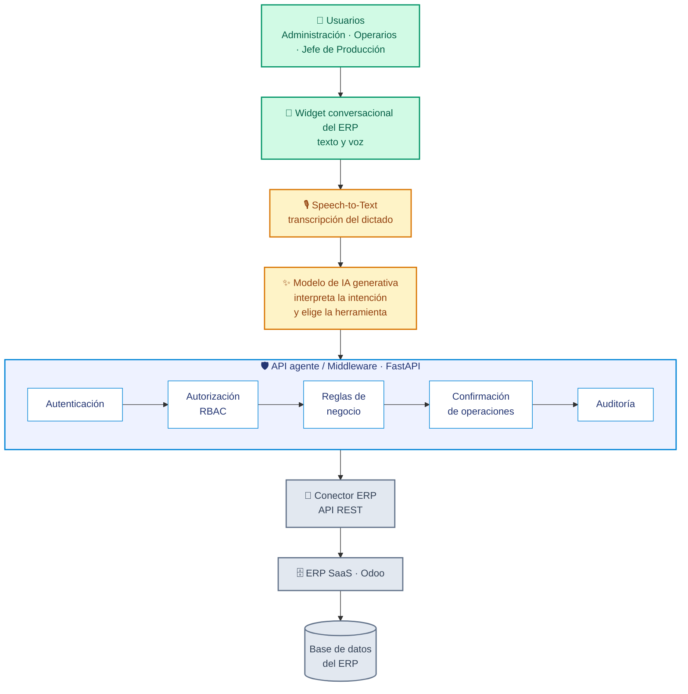
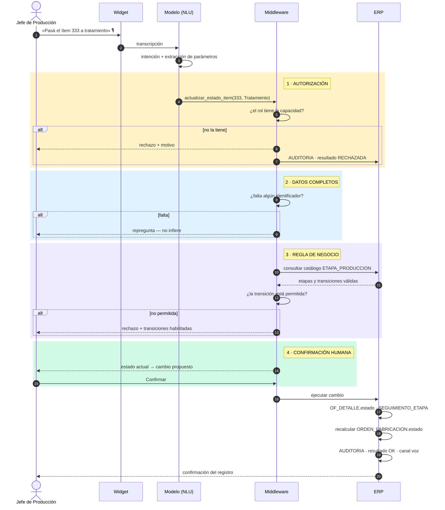
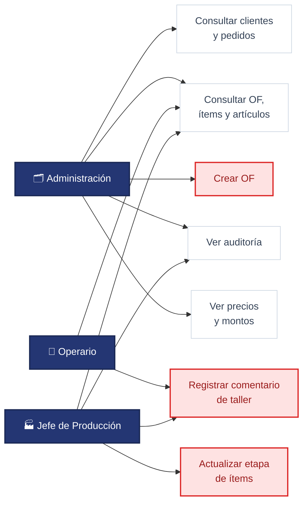
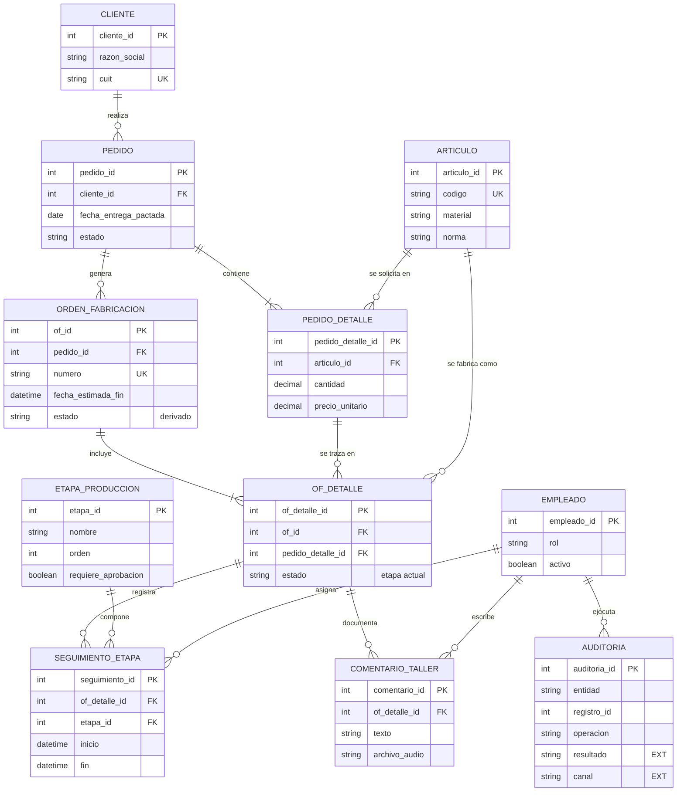
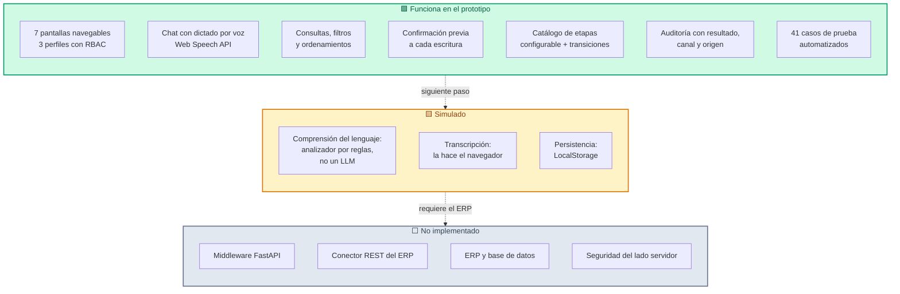
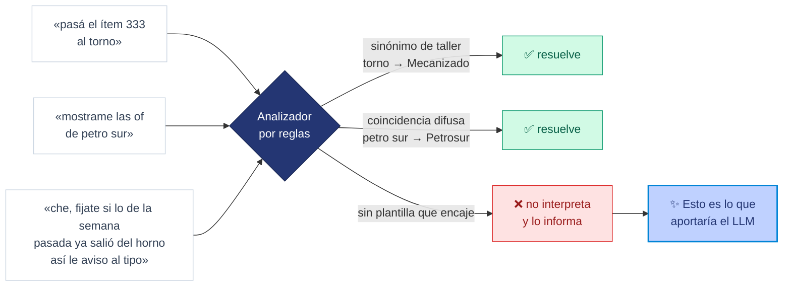

# Arquitectura de la solución — BRIMEC

Diagramas de la **Oportunidad 3** de T-09: *Asistente Conversacional para Operaciones de Producción
y Taller*, tal como se diseña en T-10.

> Los diagramas están en Mermaid para que GitHub los renderice solo. Hay una versión con los
> logotipos de las herramientas en [`STACK.md`](STACK.md).

**Cómo leer los colores:**

| | Significado |
|---|---|
| 🟩 verde | Funciona en el prototipo entregado |
| 🟨 amarillo | Simulado — el flujo se representa, la tecnología no está conectada |
| ⬜ gris | Propuesto, no implementado |

---

## 1. Arquitectura conceptual

Patrón **agente con herramientas** (*tool calling*) sobre una arquitectura **desacoplada**: el
modelo generativo nunca toca los datos.

**El punto central:** el LLM se usa *solo* para comprender lenguaje natural y redactar respuestas.
La autorización, la ejecución de transacciones y el acceso a los datos quedan bajo control del
middleware y del ERP. Esa separación es la que acota el riesgo de modificaciones indebidas.

---

## 2. Flujo de una operación de escritura

Las cuatro barreras que atraviesa cualquier cambio, en orden. Ninguna es opcional.

Confirmar, cancelar y rechazar quedan **los tres** registrados en auditoría. Cancelar no es "no
pasó nada": es evidencia de que el control funcionó.

---

## 3. Matriz de permisos (RBAC)

Los tres recuadros rojos son las **operaciones de escritura**, y cada una pertenece a un único
perfil. Administración crea OF pero no actualiza etapas ni comenta; el operario comenta pero no
actualiza; solo el Jefe de Producción cambia etapas.

---

## 4. Modelo de datos del MVP

11 de las 28 tablas del modelo destino: exactamente las que T-09 lista en *"Datos e información
necesaria"*.

### Dos decisiones que se leen en el diagrama

1. **`ORDEN_FABRICACION` no tiene `cliente_id`.** El cliente se alcanza por `PEDIDO`. Por eso
   *"las OF de Petrosur"* exige el join `OF_DETALLE → ORDEN_FABRICACION → PEDIDO → CLIENTE`.
2. **`COMENTARIO_TALLER` y `SEGUIMIENTO_ETAPA` cuelgan de `OF_DETALLE`, no de la OF.** Los
   comentarios y los cambios de etapa son **por ítem**. El estado de la OF es derivado: la etapa
   mínima de sus ítems. Por eso, si pedís *"agregá un comentario a la OF-203"* y esa OF tiene varios
   ítems, el asistente repregunta cuál.

### Lo que el modelo todavía no cubre

Las columnas marcadas `"EXT"` en `AUDITORIA` **no existen** en el ERD y el MVP las necesita:

| Falta | Por qué hace falta |
|---|---|
| `AUDITORIA.resultado` | T-09 exige registrar *"Usuario, Fecha, Acción, **Resultado**"*. Sin esa columna no hay dónde anotar un rechazo por permisos ni una cancelación |
| `AUDITORIA.canal` / `origen` | Sin ellos no se puede medir la adopción del asistente frente a las pantallas del ERP — que es la hipótesis a validar |
| Transiciones entre etapas | `ETAPA_PRODUCCION` no las modela. Haría falta una `ETAPA_TRANSICION` o un `etapa_siguiente_id` |
| `CONVERSACION` / `MENSAJE` | No existen. Las consultas de solo lectura no dejan rastro en ninguna tabla |

---

## 5. Qué está construido y qué no

> ⚠️ Los controles de permisos del prototipo corren **en el navegador**. Representan el flujo; **no
> son un control de seguridad**. En producción la validación debe ocurrir del lado del servidor.

---

## 6. El límite honesto del prototipo

T-09 descarta la automatización por reglas por rígida. El prototipo usa reglas —pero tolerantes— y
**documenta dónde se rompen**:

El caso de la derecha está cubierto por el test `LIM-01` y documentado como **CP-10** en T-10. El
template advierte que *"si el equipo no encontró ningún caso en el que la solución falle,
probablemente no probó suficiente"*. Ese es el caso.
