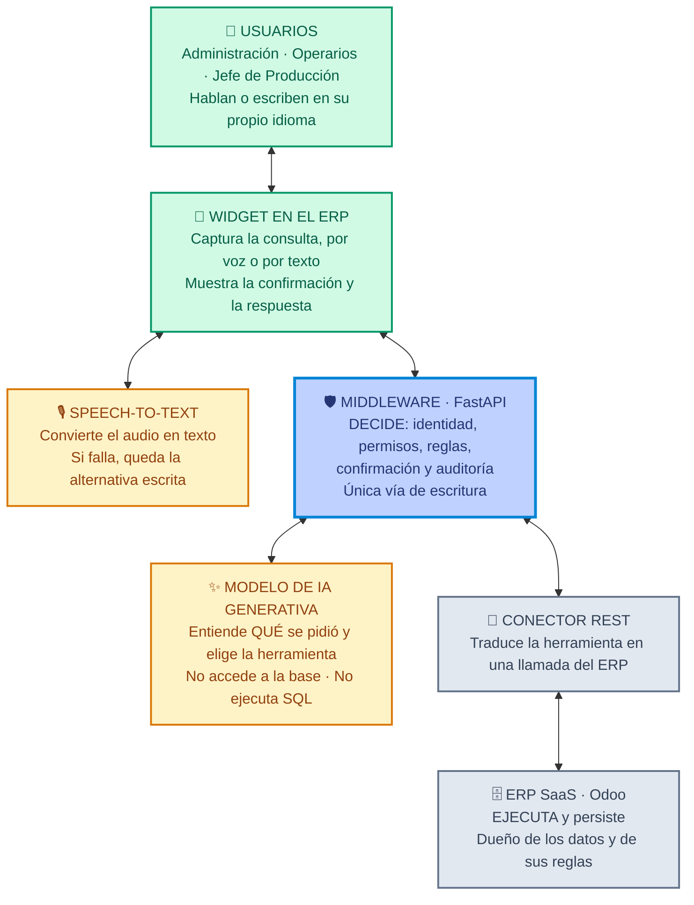

# El recorrido completo, paso a paso

Qué hace cada componente **en cada momento**, de ida y de vuelta. Pensado para que puedas responder
cualquier repregunta sobre el flujo.

Ejemplo que se sigue en todo el documento:

> El Jefe de Producción dicta: **«Pasá el ítem 333 a tratamiento»**

---

## La arquitectura, con la función de cada pieza



> Las flechas son **de doble sentido** a propósito: cada pieza participa en la ida y en la vuelta.
> El widget habla con el middleware, **no con el modelo**. La clave del proveedor del modelo nunca
> está en el navegador.

---

# 🡒 IDA

### 0 · Antes de que nadie hable

El usuario ya está autenticado **en el ERP**: su identidad y su rol vienen de ahí, no los inventa el
asistente. El middleware tiene cargado el catálogo de herramientas disponibles y, al abrir la
conversación, le consulta al ERP el **catálogo de etapas vigente** — no lo tiene escrito en el
código.

### 1 · Captura · Widget

El usuario abre el asistente dentro del ERP y dicta. Se graba el audio.

### 2 · Transcripción · Speech-to-Text

El audio se convierte en texto: `"Pasá el ítem 333 a tratamiento"`.

Si el ruido de planta arruina la transcripción, el usuario repite o pasa a escribir. La alternativa
por texto está siempre disponible — es un riesgo identificado en T-09.

### 3 · Envío · Widget → Middleware

El widget manda el texto **al middleware**, no al modelo.

> Esto no es un detalle: si el navegador hablara directo con el proveedor del modelo, la credencial
> estaría del lado del cliente y cualquiera podría usarla.

### 4 · Armado del contexto · Middleware

El middleware prepara lo que le va a mandar al modelo:

- el mensaje del usuario
- el catálogo de herramientas **filtrado por el rol**
- el contexto mínimo necesario (por ejemplo, las etapas válidas)

> **El filtrado por rol es más fuerte de lo que parece.** A un operario ni siquiera se le ofrece la
> herramienta `actualizar_estado_item`. No es que el modelo la elige y después se la rechazan: el
> modelo **no sabe que existe**. Es una segunda capa de defensa además del control del paso 6.1.

Lo que **no** se manda: credenciales, datos salariales, legajos, ni la base entera.

### 5 · Interpretación · Modelo

El modelo hace tres cosas y devuelve **texto**:

1. Determina la **intención**
2. Extrae los **parámetros**
3. Si falta un dato, **no lo inventa**: devuelve una repregunta

```json
{
  "herramienta": "actualizar_estado_item",
  "parametros": { "of_detalle_id": 333, "etapa": "Tratamiento" }
}
```

**Y ahí termina su trabajo.** Todavía no pasó nada.

### 6 · Validación · Middleware — las cuatro barreras

| # | Barrera | Qué pregunta | Si falla |
|---|---|---|---|
| 6.1 | **Autorización** | ¿El rol tiene esa capacidad? | Rechaza · audita `RECHAZADA` · salta a la vuelta |
| 6.2 | **Integridad** | ¿El ítem 333 existe? ¿La etapa está en el catálogo? | Informa · no ejecuta |
| 6.3 | **Regla de negocio** | ¿La transición Mecanizado → Tratamiento está permitida? | Rechaza y ofrece las válidas |
| 6.4 | **Confirmación** | Arma la previsualización y **se detiene** | — |

### 7 · Confirmación humana · ⏸ el flujo se detiene

El widget muestra **estado actual → cambio propuesto**, con *Confirmar* y *Cancelar*.

Hasta acá **no se escribió absolutamente nada**.

- Si **cancela** → se audita `CANCELADA` y termina. Cancelar no es "no pasó nada": es evidencia de
  que el control funcionó.
- Si **confirma** → sigue.

### 8 · Ejecución · Middleware → Conector → ERP

El middleware llama a la **API REST** del ERP. Tampoco escribe SQL.

El ERP valida **otra vez** con sus propias reglas y escribe dentro de una transacción:

- `OF_DETALLE.estado` pasa a *Tratamiento*
- se cierra la fila abierta de `SEGUIMIENTO_ETAPA` y se abre una nueva
- se recalcula `ORDEN_FABRICACION.estado` — es la etapa mínima de sus ítems
- se escribe `AUDITORIA`: usuario, fecha y hora, entidad, registro, operación, resultado y canal

> La doble validación no es redundancia inútil. El middleware valida **la política del asistente**;
> el ERP valida **sus propias reglas**, que también aplican a quien entra por sus pantallas.

---

# 🡐 VUELTA

### 9 · Resultado estructurado · ERP → Middleware

El ERP devuelve el registro actualizado, o el error. Son **datos**, no una frase.

### 10 · Redacción · Middleware → Modelo *(segunda vez)*

El middleware le pasa al modelo el resultado para que lo redacte en castellano.

> **El modelo se usa dos veces en cada interacción**: a la entrada para entender, a la salida para
> redactar. En el medio no participa.

Y acá redacta **sobre el dato que recibió** — no sobre lo que recuerda. Por eso no puede inventar un
estado o una fecha.

*(Para respuestas simples se puede saltear este paso y usar una plantilla: menos costo y menos
latencia. Es una decisión de implementación.)*

### 11 · Entrega · Widget

Se muestra el texto y, si corresponde, la tabla o el registro. Queda en el historial de la
conversación.

### 12 · Voz de salida *(opcional)*

Text-to-Speech, si el entorno lo permite. En una planta ruidosa suele convenir la pantalla.

---

## Los tres atajos: cuando el flujo se corta antes

No todas las interacciones llegan al paso 12. Conviene tener estos tres a mano:

| Caso | Dónde se corta | Qué pasa |
|---|---|---|
| **Falta un dato** | Paso 5 | El modelo devuelve una repregunta en vez de una llamada. *«¿Sobre qué ítem?»* No llega al middleware |
| **Sin permiso** | Paso 6.1 | Se rechaza, se informa el motivo y **se audita `RECHAZADA`**. No se consulta ni se escribe nada |
| **Cancelación** | Paso 7 | El usuario dice que no. Se audita `CANCELADA`. Ningún registro cambió |

---

## Y si es solo una consulta, ¿cambia?

Sí: el camino es **más corto**. Pasos 1 a 6.2, después lectura en el ERP, y vuelta por 9, 10 y 11.

**No hay confirmación** —no hay nada que confirmar— **ni escritura**. Pero el filtrado por rol del
paso 4 y la autorización del paso 6.1 **siguen aplicando**: por eso un operario no puede listar el
padrón de clientes ni ver precios.

---

## Dónde está cada paso en el prototipo

| Paso | Archivo |
|---|---|
| 1 · Captura y 11 · Entrega | `src/pages/Chat.tsx` |
| 2 · Transcripción | `src/hooks/useDictado.ts` — Web Speech API |
| 5 · Interpretación | `src/lib/nlu.ts` → `analizar()` — **simula el tool call** |
| 4, 6 · Contexto y validación | `src/lib/agente.ts` → `responder()` |
| 6.1, 6.3, 8 · Autorización, reglas y ejecución | `src/store/AppContext.tsx` → `ejecutar()` |
| 7 · Confirmación | `src/components/chat/TarjetaConfirmacion.tsx` |
| Lecturas del paso 6.2 | `src/lib/consultas.ts` |

> En el prototipo todo esto corre **en el navegador**. Representa el flujo; **no es seguridad real**.
